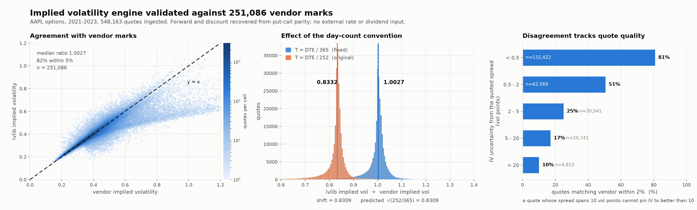
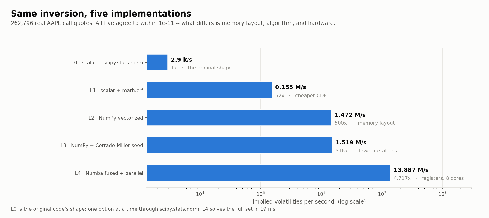

# IVchart

Implied volatility from option chains: a vectorized engine validated against vendor marks on
548k real quotes, and a web app that charts implied vs realized volatility for any ticker.

**Live:** [ivchart.vercel.app](https://ivchart.vercel.app)



## Results

| | |
|---|---|
| Speed | **13.9M IV/s** (Numba, 8-core Mac), 4,717x the original scalar loop |
| Accuracy | median ratio **1.0027** vs vendor marks, 81.9% within 5% |
| Coverage | 95.8% of quotes solved, the rest rejected as outside no-arbitrage bounds |
| Tests | 115, run in CI |

## How it works

- **Forward from put-call parity.** `C - P = df(F - K)` is a line in K, so the rate and
  dividend come from the quotes themselves.
- **Bracketed Newton.** Newton steps stay inside a bracket that always contains the root,
  with bisection as the fallback. It cannot diverge.
- **Day count.** `T = days / 365`. The original used 252 and read IV about 17% too low.



## Layout

```
ivlib/   engine: pricing, solver, market (filtering + parity), surface
app/     data pipeline and FastAPI backend
web/     React frontend
bench/   validation, speed ladder, figures
```

## Run

```bash
pip install -e ".[app,dev,bench]"
pytest
uvicorn app.api:app --port 8000          # API
cd web && npm install && npm run dev     # frontend
python -m bench.validate --plot          # reproduce the validation figure
```
